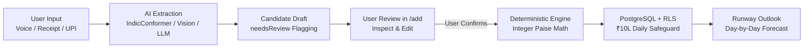

<p align="center">
  <a href="https://github.com/syed-imadulla/FLOVA">
    
  </a>
</p>

<h1 align="center">FLOVA</h1>

<p align="center">
  <strong>Every rupee has a story. FLOVA remembers.</strong>
</p>

<p align="center">
  A voice-first, deterministic financial companion engineered for irregular earners, gig delivery partners, and independent tradespeople across India.
</p>

<p align="center">
  <a href="#what-is-flova">Overview</a> •
  <a href="#key-features">Features</a> •
  <a href="#how-flova-works">How It Works</a> •
  <a href="#system-architecture">Architecture</a> •
  <a href="#getting-started">Quickstart</a> •
  <a href="#documentation-index">Documentation</a> •
  <a href="LICENSE">License</a>
</p>

<p align="center">
  <a href="LICENSE"></a>
  <a href="https://www.typescriptlang.org/"></a>
  <a href="https://react.dev/"></a>
  <a href="https://vitejs.dev/"></a>
  <a href="https://www.python.org/"></a>
  <a href="https://fastapi.tiangolo.com/"></a>
  <a href="https://github.com/syed-imadulla/FLOVA/stargazers"></a>
  <a href="https://github.com/syed-imadulla/FLOVA/network/members"></a>
  <a href="https://github.com/syed-imadulla/FLOVA/issues"></a>
  <a href="https://github.com/syed-imadulla/FLOVA/commits/main"></a>
</p>

---

## What is FLOVA?

### The Irregular Income Problem
Traditional budgeting tools assume a predictable monthly paycheck deposited on a fixed date. For over 15 million Indian gig delivery partners, cab drivers, auto drivers, and daily wage earners, earnings arrive unpredictably:
- Daily cash mixed with personal funds.
- Platform payouts subject to deductions, delays, and weekly cycles.
- Volatile demand driven by festivals, monsoon disruptions, and seasonal peaks.

When income oscillates between ₹2,000 one week and ₹7,500 the next, monthly budgeting apps fail.

### The Cash Runway Approach
FLOVA replaces rigid monthly budgets with real-time **cash runway intelligence**, answering the only question that truly matters: **"Will my available money last until my next payout?"**

- **Voice-First Recording:** Speak naturally in 10 Indian languages to record transactions on the go.
- **Deterministic Math:** Financial calculations run strictly in integer paise (`100 paise = ₹1.00`). No AI balance approximations.
- **Custodial Cash Isolation:** Third-party collections (Cash on Delivery) are segregated from personal spendable income.
- **Adaptive Safety Buffer:** Maintain an emergency reserve dynamically sized to the worker's income volatility profile.

### 📱 Native Android Experience
- **Capacitor 8.6.2 Native Wrapper:** Full native Android runtime with package ID `in.flova.app`, targeting Android 15/16 (`compileSdk 36`, `targetSdk 36`, `minSdk 24`).
- **Native Google Sign-In:** Integrated Android Credential Manager (`androidx.credentials`) via `@capgo/capacitor-social-login` with cryptographic SHA-256 raw nonce replay protection and Supabase `signInWithIdToken`.
- **Strict Portrait Orientation Lock:** Enforces vertical layout (`android:screenOrientation="portrait"`), preventing layout shifting during active phone rotation.
- **Hardware Back Navigation:** Managed back-stack handling with confirmation modals on exit.
- **Direct APK Distribution:** Production web landing page hosts verified, direct Android APK downloads (`/download/flova-latest.apk`) alongside PWA installation.

---

## Key Features

### 🎙️ Voice Intelligence
- **AI4Bharat IndicConformer (Primary STT):** High-accuracy speech recognition fine-tuned for regional Indian languages, accents, and code-switching (`kn`, `hi`, `te`, `ta`, `ml`, `en`).
- **Groq Whisper (Fallback STT):** Automated, fail-safe failover to `whisper-large-v3-turbo` if the primary service times out (>7s) or encounters errors.
- **Multi-Transaction Parsing:** Separates multiple financial events from a single sentence (e.g., *"Spent ₹250 on petrol and earned ₹800 from delivery"*) without amount duplication.

### 📸 Smart Capture & Receipt OCR
- **Paper Receipt Scanning:** Extracts line items, quantities, taxes, and totals with automatic arithmetic discrepancy checking.
- **UPI Screenshot Intelligence:** Classifies payment status (`COMPLETED`, `PENDING`, `FAILED`) and extracts 12-digit UTR reference numbers from standard UPI payment screenshots (including Google Pay, PhonePe, Paytm, and CRED). All third-party names are trademarks of their respective owners and are referenced solely for technical format compatibility.
- **Duplicate UTR Safeguard:** Prevents double-counting by rejecting duplicate transaction entries with matching reference numbers.
- **Client Image Optimizer:** Compresses and resizes camera uploads up to 20 MB down to sub-megabyte payloads client-side before transmission.

### 🧾 Invoice Intelligence
- **Receivables & Payables:** Track contractor and client invoices with counterparties, line items, and due dates.
- **Partial Settlements:** Record multi-part payments with automatic status lifecycle (`unpaid` → `partially_paid` → `paid` → `overdue`).
- **No Double-Counting:** Unsettled receivables represent expected future cash flow and never inflate the confirmed bank balance.

### 📐 Financial Engine & Runway
- **Integer Paise Arithmetic:** Pure TypeScript engine (`frontend/src/engine/`) guarantees exact balance precision with zero floating-point drift.
- **Custodial Money Segregation:** Cash on Delivery (COD) collections are tagged `ownership: 'not_mine'` and excluded from personal runway calculations.
- **Adaptive Safety Buffer:** Dynamically calculates 3 to 21 days of reserve buffer based on work profile and earnings variability.
- **30-Day Forward Runway:** Day-by-day cash flow simulation alerting users to buffer shortfalls before actual cash deficits occur.
- **WISH 2.0 Micro-Goals:** Persistent savings goals that absorb surplus earnings during high-revenue weeks.

> **Feature Status Overview:** Core Voice Capture, IndicConformer + Whisper, Receipt/UPI OCR, Invoices, Paise Math, Runway, and Makefile Tunneling are **Implemented**. PWA Web Share Target and in-browser ONNX inference are **Experimental**. Bank statement PDF parsing and direct UPI deep-linking are **Planned**.

---

## How FLOVA Works

FLOVA enforces an **"AI Suggests, User Confirms"** invariant. AI models produce reviewable candidate drafts, but never commit transactions directly to the ledger without user approval.



---

## System Architecture

```mermaid
flowchart TD
    subgraph Client["Frontend Client (React 18 + Vite PWA)"]
        UI["UI Views & Screens"]
        VoiceComp["Voice Capture"]
        CaptureComp["Smart Capture"]
        ReviewComp["Review & Confirmation (/add)"]
        Engine["Deterministic Engine (Paise Math)"]
        UI --> VoiceComp & CaptureComp
        VoiceComp & CaptureComp --> ReviewComp
        ReviewComp --> Engine
    end

    subgraph Serverless["Supabase Edge Functions"]
        VoiceFunc["process-voice"]
        VisionFunc["extract-receipt"]
    end

    subgraph AI["Speech & Vision Layer"]
        STT["Primary STT: IndicConformer (:8001)"]
        Whisper["Fallback STT: Groq Whisper Large v3"]
        Vision["Vision OCR: Groq Qwen 2.5 27B"]
        LLM["Intent Parser: Groq Llama 3.3 70B"]
    end

    subgraph DB["PostgreSQL 15 (Supabase)"]
        Tables[(Transactions, Invoices, Profiles, WISH)]
        RLS["Row Level Security Policies"]
        Triggers["₹10L Calendar-Day Limit Triggers"]
        Tables --- RLS & Triggers
    end

    VoiceComp -- Audio Blob --> VoiceFunc
    VoiceFunc -- 1. Primary --> STT
    VoiceFunc -. 2. Fallback .-> Whisper
    VoiceFunc -- Transcript --> LLM
    LLM -- Candidate DTO --> ReviewComp

    CaptureComp -- Image Stream --> VisionFunc
    VisionFunc --> Vision
    Vision -- Receipt DTO --> ReviewComp

    Engine -- Confirmed Transactions (JWT) --> DB
```

*For in-depth architectural contracts and system boundaries, see [`docs/ARCHITECTURE.md`](docs/ARCHITECTURE.md).*

---

## Technology Stack

| Layer | Technologies | Description |
|---|---|---|
| **Frontend PWA** | React 18, Vite 5.4, TypeScript 5.6, Tailwind CSS 3.4 | Mobile-first progressive web app with responsive layout |
| **Financial Engine** | Pure TypeScript (`frontend/src/engine/`) | Integer paise math, runway simulation, adaptive buffer |
| **Edge Functions** | Deno, TypeScript, Supabase CLI | Serverless ingestion, CORS headers, model failover |
| **Primary Speech** | AI4Bharat IndicConformer, FastAPI, ONNX Runtime | High-speed local inference for Indic languages |
| **Fallback Speech** | Groq Whisper Large v3 Turbo | Cloud transcription fallback on timeout or error |
| **Vision & Intent** | Groq Qwen 2.5 27B Vision, Groq Llama 3.3 70B | Structured line-item OCR and financial intent extraction |
| **Database & Auth** | PostgreSQL 15, Supabase Auth, Row Level Security | Multi-tenant tenant isolation and row-level locks |
| **Process Runner** | GNU Make, Python 3 dev-runner, Cloudflare Tunnel | One-command orchestration with public HTTPS tunneling |

---

## Getting Started

### Prerequisites
- **GNU Make:** `make` (Available on Linux/macOS. Ubuntu: `sudo apt install make`, macOS: `brew install make`)
- **Node.js:** Node.js 20+ with npm (`node --version`)
- **Python:** Python 3.10+ with `python3-venv` (`python3 --version`)
- **FFmpeg:** Required for audio transcoding (`sudo apt install ffmpeg` or `brew install ffmpeg`)

### 1. Clone & Install
```bash
# Clone the repository
git clone https://github.com/syed-imadulla/FLOVA.git
cd FLOVA

# Install all dependencies across Frontend, Backend, and STT
make install
```

### 2. Configure Environment
```bash
# Copy frontend environment template
cp frontend/.env.example frontend/.env.local
```
Add your Supabase project credentials in `frontend/.env.local`:
```env
VITE_SUPABASE_URL=https://your-project.supabase.co
VITE_SUPABASE_ANON_KEY=your-supabase-anon-key
```

### 3. Start Development Server
```bash
# Start Frontend, STT Microservice, and Public Tunnel concurrently
make dev
```
`make dev` automatically starts:
- **Frontend:** [http://localhost:5173](http://localhost:5173)
- **STT Service:** [http://localhost:8001](http://localhost:8001) (Health: `/health`)
- **Live Public Tunnel:** Generates a secure HTTPS link (e.g. `https://<name>.trycloudflare.com`) for direct mobile PWA testing.

*(To run locally without an external tunnel, use `make dev TUNNEL=0`).*

---

## Development Workflow

The root `Makefile` provides verified commands for development, testing, and builds:

| Command | Description |
|---|---|
| `make dev` | Start Frontend, STT, and Public HTTPS Tunnel concurrently |
| `make tunnel` | Start only the public HTTPS tunnel for the Vite frontend |
| `make frontend` | Start only the React + Vite frontend server (:5173) |
| `make stt` | Start only the IndicConformer FastAPI STT service (:8001) |
| `make dev-status` | Inspect status, active ports, and health of local services |
| `make stop` | Terminate any running processes on dev ports (5173 / 8001) |
| `make test` | Run ALL automated test suites (Frontend + Backend + AI) |
| `make test-frontend` | Run frontend services and financial engine tests |
| `make test-backend` | Run database schema RLS and demo seeding tests |
| `make test-stt` | Run Python IndicConformer STT and engine unit tests |
| `make lint` | Run TypeScript type checks across the frontend (`tsc -b`) |
| `make build` | Compile production frontend bundle (`tsc -b && vite build`) |
| `make clean` | Remove temporary build files and caches |
| `make help` | Display interactive Makefile command guide |

---

## Project Structure

```text
FLOVA/
├── Makefile                     # Root development workflows and automation
├── LICENSE                      # Open-source MIT License
├── README.md                    # Project documentation
├── CLAUDE.md                    # Engineering invariants and coding guidelines
├── scripts/
│   └── dev-runner.py            # Process supervisor with port checks & tunneling
├── docs/                        # Detailed architectural and technical guides
│   ├── assets/                  # Brand assets and application icons
│   ├── ARCHITECTURE.md          # System philosophy and design contracts
│   ├── VOICE-STT.md             # IndicConformer and Whisper audio pipeline
│   ├── SMART-CAPTURE.md         # Receipt OCR and UPI screenshot parsing
│   ├── INVOICE-INTELLIGENCE.md  # Invoices, payables, and settlements
│   ├── FINANCIAL-ENGINE.md      # Integer paise arithmetic and invariants
│   ├── ADAPTIVE-BUFFER.md       # Safety buffer and runway formulas
│   ├── SECURITY.md              # Row Level Security and authentication
│   ├── DEPLOYMENT.md            # Production deployment instructions
│   ├── ENVIRONMENT.md           # Environment variables and secrets reference
│   └── TESTING.md               # Automated testing strategies
├── frontend/                    # Client React 18 + Vite PWA
│   ├── src/
│   │   ├── engine/              # Deterministic financial calculations (paise)
│   │   ├── services/            # Client data services (voice, receipt, data)
│   │   ├── screens/             # UI screen components
│   │   └── lib/                 # Utilities (money formatting, Supabase client)
│   └── package.json             # Frontend dependencies
├── backend/                     # Database migrations and serverless functions
│   └── supabase/
│       ├── functions/           # Deno Edge Functions (process-voice, extract-receipt)
│       └── migrations/          # Idempotent PostgreSQL schema migrations
└── ai-engine/                   # Python STT microservice & reference engine
    ├── stt_service/             # FastAPI IndicConformer microservice
    └── tests/                   # Pytest test suites
```

---

## Security & Financial Principles

1. **Deterministic Financial Math:** Authoritative balances and runway projections are computed entirely in integer paise (`100 paise = ₹1.00`) by pure TypeScript logic. LLMs are strictly forbidden from performing arithmetic.
2. **AI Suggests, User Confirms:** Every voice transcript and receipt scan produces an unconfirmed candidate. No transaction is written to the database without explicit user confirmation.
3. **Custodial Money Segregation:** Third-party cash collections (e.g. Cash on Delivery) are tagged `ownership: 'not_mine'` and never counted toward personal spendable runway.
4. **Receivable Segregation:** Expected gig payouts and unpaid invoices represent future receivables; they are excluded from the available cash balance until confirmed as received.
5. **₹10 Lakh Safeguard Limits:** Maximum single transaction (₹10,00,000) and calendar-day aggregate (₹10,00,000) limits are enforced in PostgreSQL triggers with profile row-level locks.
6. **Zero Client Secrets:** The frontend bundle contains only public publishable variables (`VITE_*`). All private tokens remain securely in server-side vaults.

---

## Documentation Index

For in-depth technical specifications, consult the dedicated guides in the [`docs/`](docs/) directory:

- 🏛️ [System Architecture](docs/ARCHITECTURE.md) — System boundaries, components, and philosophy
- 📱 [Android Implementation Report](docs/android-implementation-report.md) — Native Capacitor packaging, SDK configuration, and device verification
- 📋 [Phase 1 Final Completion Report](docs/PHASE_1_FINAL_COMPLETION_REPORT.md) — Production infrastructure, remote Supabase lockdown, and Whisper STT
- 📋 [Phase 2 Final Completion Report](docs/PHASE_2_FINAL_COMPLETION_REPORT.md) — Android build stability, portrait lock, and Redmi 12 5G QA sign-off
- 📋 [Phase 2 Final QA Report](docs/PHASE_2_FINAL_QA_REPORT.md) — Reconciled test metrics, zero secret scan verification, and device test logs
- 📋 [Phase 3.1 Google Play Launch Audit](docs/PHASE_3_1_GOOGLE_PLAY_AUDIT.md) — Launch readiness audit, legal prerequisites, and Data Safety declaration
- 🎙️ [Speech-to-Text Pipeline](docs/VOICE-STT.md) — IndicConformer checkpoints, audio normalization, and failover
- 📸 [Smart Capture & OCR](docs/SMART-CAPTURE.md) — Receipt line-item extraction and UPI reference handling
- 🧾 [Invoice Intelligence](docs/INVOICE-INTELLIGENCE.md) — Receivables, payables, and settlement reconciliation
- 📐 [Deterministic Financial Engine](docs/FINANCIAL-ENGINE.md) — Integer paise math and balance formulas
- 🛡️ [Adaptive Safety Buffer](docs/ADAPTIVE-BUFFER.md) — Volatility-based reserves and runway calculations
- 🔒 [Security & Row Level Security](docs/SECURITY.md) — Tenant isolation and database protection
- 🚀 [Deployment Guide](docs/DEPLOYMENT.md) — Vercel, Supabase, and systemd deployment
- ⚙️ [Environment Variables Reference](docs/ENVIRONMENT.md) — Full configuration and secrets guide
- 🧪 [Testing & Verification](docs/TESTING.md) — Multi-tier test suite execution and test authoring

---

## Contributing

Contributions are welcome! Please follow these steps:

1. **Fork the Repository:** Create your own fork of `syed-imadulla/FLOVA`.
2. **Create a Feature Branch:**
   ```bash
   git checkout -b feature/your-feature-name
   ```
3. **Verify Code Quality:**
   ```bash
   make lint
   make test
   make build
   ```
4. **Submit a Pull Request:** Open a PR against the `dev` branch with a clear description of your changes and test verification results.

---

## License

This project is open-source software licensed under the [MIT License](LICENSE).

Copyright (c) 2026 Syed Imadulla

*AI4Bharat IndicConformer models are developed by the AI4Bharat research team at IIT Madras and are governed by their respective research and open-source licenses.*

---

## Acknowledgements

- **[AI4Bharat](https://ai4bharat.iitm.ac.in/):** Open-source speech technology and IndicConformer checkpoints for Indian languages.
- **[Groq](https://groq.com/):** Low-latency Llama 3.3, Qwen 2.5 Vision, and Whisper inference.
- **[Supabase](https://supabase.com/):** PostgreSQL database, Row Level Security, Auth, and Edge Functions.
- **[Vite](https://vitejs.dev/) & [React](https://react.dev/):** Frontend build tooling and component architecture.
