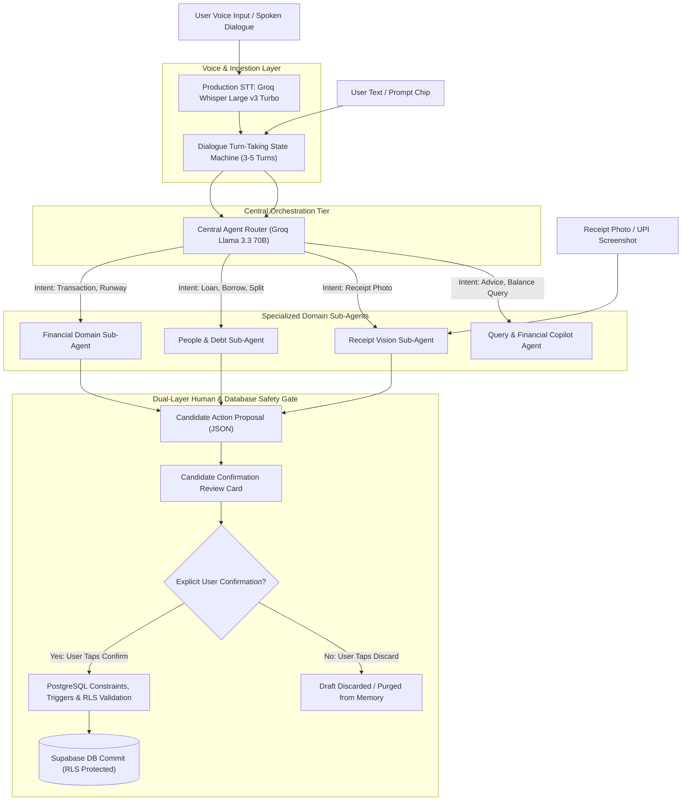
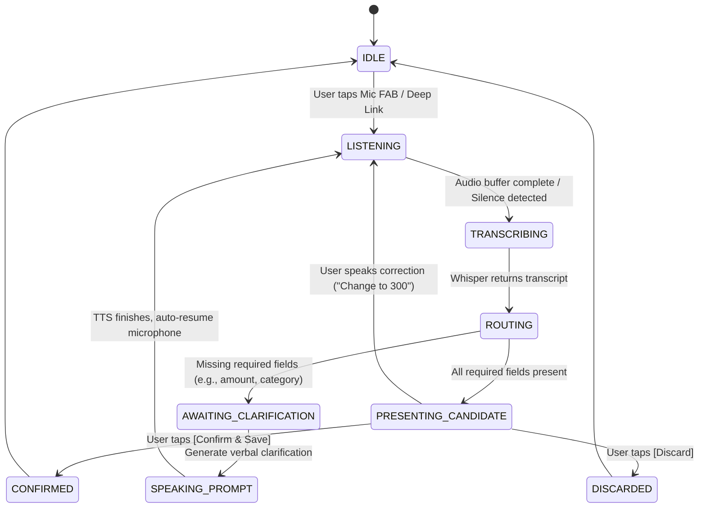

# FLOVA 2.0 — Multi-Agent Intelligence & Voice Architecture

**Document Version:** 2.0.0-PROD-PLAN-REV2  
**Status:** Approved Architectural Baseline  
**Date:** 2026-11-25  
**Author:** Principal System Architect & Lead Engineer  
**Repository:** `https://github.com/syed-imadulla/FLOVA`  
**Current Production Baseline:** `v1.0.1` (Commit `ab4bdef`)  
**Target General Availability:** `v2.0.0`

---

## 1. Multi-Agent System Overview

FLOVA 2.0 replaces monolithic intent extraction with an asynchronous multi-agent orchestration architecture. Instead of forcing a single model prompt to handle speech parsing, runway math, debt reconciliation, and vision OCR simultaneously, FLOVA 2.0 routes tasks across specialized sub-agents.



---

## 2. Central Agent Router & Domain Sub-Agents

### 2.1 Central Agent Router
The Central Agent Router operates as the orchestrator inside the `process-voice` Edge Function. Its responsibility is intent classification, context expansion, and fast-path routing.

- **Zero Database Write Privileges:** The Edge Function operates with anonymous/public client scope or user JWT. It does NOT possess Supabase Service Role keys and cannot write directly to any table.
- **Fast-Path Deterministic Bypasses:** Simple navigational keywords ("open history", "show runway") bypass LLM inference entirely and resolve client-side in under 10ms.
- **Intent Taxonomy:**
  - `INTENT_LOG_TRANSACTION`: Direct income, allowance, or living/work expense.
  - `INTENT_PEER_DEBT`: Lending, borrowing, or repayment involving a counterparty.
  - `INTENT_SPLIT_EXPENSE`: Multi-person shared bill division.
  - `INTENT_FINANCIAL_QUERY`: Inquiries regarding runway, balances, or spending envelopes.
  - `INTENT_CLARIFICATION_REPLY`: User answering a prior assistant clarification prompt.

### 2.2 Domain Sub-Agents

1. **Financial Domain Sub-Agent:**
   - **Role:** Extracts transaction amount, categorizes expenditure (`living` vs `work`), determines necessity (`essential` vs `discretionary`), and sets money ownership (`mine` vs `not_mine`).
   - **Math Verification:** Converts spoken quantities into integer paise (`"four hundred fifty"` -> `45000`). Flags ambiguous currency amounts.
2. **People & Debt Sub-Agent:**
   - **Role:** Resolves peer names against the user's `people` directory (using fuzzy string matching with Levenshtein distance $\le 2$).
   - **Directionality Classification:** Distinguishes between `"I borrowed 500 from Amit"` (`direction: you_owe`) and `"I lent 500 to Amit"` (`direction: they_owe`).
3. **Receipt Vision Sub-Agent:**
   - **Role:** Analyzes receipt photos using Groq Vision (`meta-llama/llama-4-maverick-17b-128e-instruct` / `llama-3.2-11b-vision-preview`).
   - **Extraction Scope:** Merchant name, bill date, payment method, tax/GST amounts, and itemized line items.
   - **Mathematical Cross-Validation:** Validates that $\sum \text{items} + \text{taxes} = \text{total}$. Flags discrepancies for user resolution.
4. **Query & Financial Copilot Agent:**
   - **Role:** Answers conversational questions ("Can I afford a 2000 rupee dinner this weekend?") by querying the deterministic runway simulator with a speculative outflow.

---

## 3. Dialogue Turn-Taking State Machine

FLOVA 2.0 maintains a deterministic client-side dialogue state machine supporting up to 5 turns of conversational context.



### Conversational Memory Buffer:
The client maintains a rolling context window of up to 5 dialogue turns in memory:
```typescript
export interface DialogueTurn {
  turnId: string;
  role: 'user' | 'assistant';
  transcript: string;
  detectedIntent?: string;
  partialCandidate?: Partial<CandidateAction>;
  timestamp: number;
}
```

---

## 4. Speech Pipeline: STT, TTS & Indic Support

### 4.1 Production Speech-to-Text (STT)
- **Primary Production Engine:** Groq Whisper (`whisper-large-v3-turbo`) hosted on Groq Cloud via Supabase Edge Function `process-voice`.
  - Latency: ~400–800ms for 5 seconds of audio.
  - Multi-language support: High accuracy on Indian English, Hindi, and Kannada.
- **Client Fallback:** Web Speech API (`webkitSpeechRecognition`) on supported Android WebViews and browsers for zero-latency local preview.

### 4.2 IndicConformer Status: Strictly Dormant
- As mandated by project constraints, the `indicconformer/` service remains completely dormant in production.
- Its API contracts and mock container configs are preserved in the repository for future evaluation, but zero production requests route to it.

### 4.3 Text-to-Speech (TTS) Pipeline
- **Synthesis:** Clear, natural audio feedback confirming parsed actions.
- **Turn Behavior:** The assistant speaks succinct acknowledgments:
  - *"Got it. 150 rupees for lunch. Tap confirm to save."*
  - *"Who did you lend the 500 rupees to?"*
- **Speech Synthesis Fallback:** If device audio is muted or speech synthesis is unsupported, the assistant displays prominent visual text dialogue bubbles in the bottom sheet.

---

## 5. Non-Negotiable Human Confirmation & Dual-Layer Validation Gate

**Under NO circumstances does any AI model, Edge Function, or automated agent insert, update, or delete records directly in the Supabase database.**

1. **Candidate Action Schema:**
   Agents emit an immutable proposal object:
   ```typescript
   export interface CandidateAction {
     candidateId: string;
     actionType: 'TRANSACTION' | 'PEER_DEBT' | 'SPLIT' | 'PAYOUT_SYNC';
     confidence: number;
     payload: {
       amountPaise: number;
       description: string;
       category: string;
       /** Maps to transactions.transaction_type ('income'|'expense') + inflow_category, or peer_debts/debt_settlements */
       targetDomain: 'transaction' | 'peer_debt' | 'debt_settlement';
       flowType: 'income' | 'expense' | 'borrowed' | 'lent' | 'repayment_in' | 'repayment_out' | 'pocket_money' | 'family_support' | 'gift' | 'donation';
       expenseType?: 'living' | 'work';
       moneyOwnership?: 'mine' | 'not_mine';
       personId?: string;
       personName?: string;
       direction?: 'you_owe' | 'they_owe';
       dueDate?: string;
     };
     missingFields: string[];
     requiresClarification: boolean;
     createdAt: number;
   }
   ```

2. **Dual-Layer Validation Enforcement:**
   - **Interaction Layer (Human Confirmation):** The proposal renders inside the Candidate Review Drawer. Persistence is triggered ONLY by the physical click/tap handler of the `[Confirm & Save]` button. Closing or discarding purges the draft from memory.
   - **Database Enforcement Layer:** UI confirmation is a required user interaction, but **not a substitute for server and database validation.** Even if a rogue client attempts a direct insert, PostgreSQL constraints (`amount_paise > 0`, non-null fields, foreign key constraints), Row Level Security (`auth.uid() = user_id`), and trigger validations strictly enforce data integrity.
