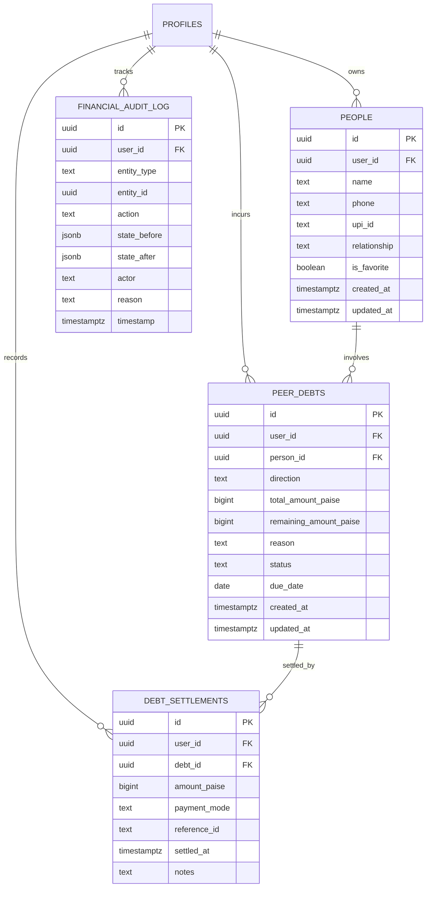

# FLOVA 2.0 — Financial Domain Model & Mathematical Specification

**Document Version:** 2.0.0-PROD-PLAN-REV2  
**Status:** Approved Architectural Baseline  
**Date:** 2026-11-25  
**Author:** Principal System Architect & Lead Engineer  
**Repository:** `https://github.com/syed-imadulla/FLOVA`  
**Current Production Baseline:** `v1.0.1` (Commit `ab4bdef`)  
**Target General Availability:** `v2.0.0`

---

## 1. Absolute Financial Invariants

The FLOVA financial core is built upon absolute mathematical invariants. Any code modifying balances, calculating runways, or tracking peer debts must strictly satisfy these principles:

### Invariant 1: Integer-Paise Precision
All monetary quantities are stored and manipulated strictly as integers in **paise** ($1\text{ INR} = 100\text{ paise}$).
- Floating-point calculations (`number` with decimals) are prohibited in the domain engine.
- Arithmetic operations must use safe checked functions (`safeAdd`, `safeSub`, `safeMul`, `safeDiv`) with integer bounds checking.

$$\text{Paise} = \text{round}(\text{INR} \times 100), \quad \text{where } \text{Paise} \in \mathbb{Z}$$

### Invariant 2: Single Source of Truth & Zero Duplication
To guarantee 100% backward compatibility with v1.0.1 clients and eliminate duplicate cash movements:
1. **`transactions` Table (Consumption & Non-Debt Inflows):**
   - Retains `transaction_type IN ('income', 'expense')`.
   - Adds nullable `inflow_category` (`'earned' | 'family_support' | 'pocket_money' | 'gift' | 'donation'`), defaulting to `'earned'` for `'income'` rows.
   - **Earned Income** (`inflow_category = 'earned'`) is strictly separated from **Family Support**, **Pocket Money**, **Gifts**, and **Donations** in P&L and earnings analytics.
2. **`peer_debts` & `debt_settlements` Tables (Peer Borrowing, Lending & Repayments):**
   - **Single Source of Truth** for all `borrowed`, `lent`, `repayment_in`, and `repayment_out` movements.
   - **Zero Duplication Rule:** Borrowing, lending, and repayments are **NEVER** duplicated as rows in `transactions` or `commitments`.
   - Each movement is recorded once and counted once in cash balance, liability, and runway calculations.

### Invariant 3: Custodial Cash (`not_mine` / COD) Segregation
Cash held in custody for an employer, client, or delivery platform (e.g. Cash-on-Delivery collected on platform orders) is tagged `money_ownership = 'not_mine'`.
- Custodial cash is strictly excluded from owned cash, available liquidity, and sustainable runway.

---

## 2. Single Source of Truth: Cash Balance & Peer Debt Mechanics

Let:
- $\text{TransactionsNetCash}_{\text{mine}} = \sum \text{income}_{\text{mine}} - \sum \text{expense}_{\text{mine}}$ (from `transactions` where `money_ownership = 'mine'`)
- $\text{PeerDebtNetCash} = \sum \text{borrowed} - \sum \text{lent} + \sum \text{repayment\_in} - \sum \text{repayment\_out}$ (from `peer_debts` and `debt_settlements`)

Then **Net Owned Cash** is:
$$C_{\text{owned}} = \text{TransactionsNetCash}_{\text{mine}} + \text{PeerDebtNetCash}$$

### Flow-by-Flow Accounting Impact

| Flow Type | Source Table | Cash ($C_{\text{owned}}$) | Peer Liability ($L_{\text{owed}}$) | Peer Receivable ($A_{\text{owed\_to\_user}}$) | Earned Income (P&L) | Consumption Expense (P&L) |
| :--- | :--- | :--- | :--- | :--- | :--- | :--- |
| `income` (`earned`) | `transactions` | $+ \Delta$ | $0$ | $0$ | $+ \Delta$ | $0$ |
| `income` (`family_support`, `pocket_money`, `gift`, `donation`) | `transactions` | $+ \Delta$ | $0$ | $0$ | $0$ (Tracked separately) | $0$ |
| `expense` (`living` / `work`) | `transactions` | $- \Delta$ | $0$ | $0$ | $0$ | $+ \Delta$ |
| `borrowed` (`you_owe`) | `peer_debts` | $+ \Delta$ | $+ \Delta$ | $0$ | $0$ | $0$ |
| `lent` (`they_owe`) | `peer_debts` | $- \Delta$ | $0$ | $+ \Delta$ | $0$ | $0$ |
| `repayment_out` | `debt_settlements` | $- \Delta$ | $- \Delta$ | $0$ | $0$ | $0$ |
| `repayment_in` | `debt_settlements` | $+ \Delta$ | $0$ | $- \Delta$ | $0$ | $0$ |

---

## 3. Available Liquidity vs. Sustainable Runway (Mathematical Model)

FLOVA 2.0 explicitly separates **Available Liquidity** (what cash you can physically spend over horizon $H$) from **Sustainable Runway** (how long you can survive on unencumbered, debt-free capital without relying on borrowed money).

### 3.1 State Variables
- $C_{\text{owned}} \in \mathbb{Z}$: Net owned cash (bank + cash in hand, excluding `not_mine` custodial funds).
- $H \in \mathbb{Z}^+$: Planning horizon in days (default $H = 30$).
- $K_{\text{bills}}(H) \in \mathbb{Z}^+$: Non-debt upcoming commitments from `commitments` (`status = 'upcoming'`, `due_date <= today + H`).
- $K_{\text{debt\_due}}(H) \in \mathbb{Z}^+$: Active peer debt repayments (`direction = 'you_owe'`, `status IN ('active', 'partially_settled')`, `due_date <= today + H`) read directly from `peer_debts.remaining_amount_paise`.
- $L_{\text{outstanding}} \in \mathbb{Z}^+$: Total unpaid borrowed principal (`direction = 'you_owe'`, `status IN ('active', 'partially_settled')`) across **all** due dates (including $> H$ or undated). Note: $L_{\text{outstanding}} \ge K_{\text{debt\_due}}(H)$.
- $B \in \mathbb{Z}^+$: Reserved adaptive emergency cushion buffer.
- $D_{\text{burn}} \in \mathbb{Z}^+$: Average daily essential living burn rate in paise/day.

### 3.2 Dual Runway Equations (Zero Double-Counting)

1. **Available Liquidity (Cash-Flow View over Horizon $H$):**
   $$\text{Available Liquidity}(H) = \max\Big(0,\, C_{\text{owned}} - K_{\text{bills}}(H) - K_{\text{debt\_due}}(H) - B\Big)$$
   $$\text{Liquid Runway Days} = \left\lfloor \frac{\text{Available Liquidity}(H)}{D_{\text{burn}}} \right\rfloor \quad (\text{if } D_{\text{burn}} > 0)$$

2. **Sustainable Runway (Unencumbered Capital View):**
   Borrowed capital **must never artificially inflate Sustainable Runway**. Because $L_{\text{outstanding}}$ already includes all unpaid borrowed principal (both $\le H$ and $> H$), we subtract $L_{\text{outstanding}}$ and **exclude** $K_{\text{debt\_due}}(H)$ so debt is never double-counted:
   $$\text{Sustainable Capital}(H) = \max\Big(0,\, C_{\text{owned}} - L_{\text{outstanding}} - K_{\text{bills}}(H) - B\Big)$$
   $$\text{Sustainable Runway Days} = \left\lfloor \frac{\text{Sustainable Capital}(H)}{D_{\text{burn}}} \right\rfloor \quad (\text{if } D_{\text{burn}} > 0)$$

### 3.3 Worked Numerical Examples (Integer Paise & INR)

Assume $H = 30\text{ days}$, $K_{\text{bills}}(30) = ₹2,000$ ($200,000\text{ p}$), $B = ₹1,000$ ($100,000\text{ p}$), $D_{\text{burn}} = ₹200/\text{day}$ ($20,000\text{ p/day}$).

#### Step 1: Baseline State
- Owned Cash $C_{\text{owned}} = ₹10,000$ ($1,000,000\text{ p}$), $L_{\text{outstanding}} = ₹0$.
- **Available Liquidity:** $10,000 - 2,000 - 0 - 1,000 = \mathbf{₹7,000}$ $\rightarrow$ **35 days**.
- **Sustainable Capital:** $10,000 - 0 - 2,000 - 1,000 = \mathbf{₹7,000}$ $\rightarrow$ **35 days**.

#### Step 2: Borrowing ₹5,000 (Due in 60 days, $> H$)
- `peer_debts` row inserted: `direction = 'you_owe'`, `total_amount_paise = 500000`, `remaining_amount_paise = 500000`.
- $C_{\text{owned}}$ increases to $₹15,000$; $L_{\text{outstanding}} = ₹5,000$; $K_{\text{debt\_due}}(30) = ₹0$; Earned Income $= ₹0$ change.
- **Available Liquidity:** $15,000 - 2,000 - 0 - 1,000 = \mathbf{₹12,000}$ $\rightarrow$ **60 days** (real liquid cash available today).
- **Sustainable Capital:** $15,000 - 5,000 - 2,000 - 1,000 = \mathbf{₹7,000}$ $\rightarrow$ **35 days** (borrowed capital does **not** inflate sustainable runway!).

#### Step 2b (Variant): Borrowing ₹5,000 (Due in 10 days, $\le H$)
- $K_{\text{debt\_due}}(30) = ₹5,000$; $L_{\text{outstanding}} = ₹5,000$.
- **Available Liquidity:** $15,000 - 2,000 - 5,000 - 1,000 = \mathbf{₹7,000}$ $\rightarrow$ **35 days**.
- **Sustainable Capital:** $15,000 - 5,000 - 2,000 - 1,000 = \mathbf{₹7,000}$ $\rightarrow$ **35 days** (counted once, zero double-counting!).

#### Step 3: Lending ₹3,000 to a Friend (Continuing from Step 2)
- `peer_debts` row inserted: `direction = 'they_owe'`, `total_amount_paise = 300000`, `remaining_amount_paise = 300000`.
- $C_{\text{owned}}$ drops to $₹12,000$; Peer Receivable $= ₹3,000$; Consumption Expense $= ₹0$ change.
- **Available Liquidity:** $12,000 - 2,000 - 0 - 1,000 = \mathbf{₹9,000}$ $\rightarrow$ **45 days**.
- **Sustainable Capital:** $12,000 - 5,000 - 2,000 - 1,000 = \mathbf{₹4,000}$ $\rightarrow$ **20 days**.

#### Step 4: Partial Repayment Out (Repaying ₹2,000 of the ₹5,000 Debt)
- `debt_settlements` row inserted: `amount_paise = 200000` linked to the `you_owe` debt.
- `peer_debts.remaining_amount_paise` updates atomically to $300,000$ ($₹3,000$), `status = 'partially_settled'`.
- $C_{\text{owned}}$ drops to $₹10,000$; $L_{\text{outstanding}}$ drops to $₹3,000$.
- **Available Liquidity:** $10,000 - 2,000 - 0 - 1,000 = \mathbf{₹7,000}$ $\rightarrow$ **35 days**.
- **Sustainable Capital:** $10,000 - 3,000 - 2,000 - 1,000 = \mathbf{₹4,000}$ $\rightarrow$ **20 days** (unchanged, because paying debt with cash leaves net unencumbered capital identical).

#### Step 5: Partial Repayment In (Friend Repays ₹1,500 of the ₹3,000 Lent)
- `debt_settlements` row inserted: `amount_paise = 150000` linked to the `they_owe` debt.
- `peer_debts.remaining_amount_paise` updates atomically to $150,000$ ($₹1,500$), `status = 'partially_settled'`.
- $C_{\text{owned}}$ increases to $₹11,500$; Earned Income $= ₹0$ change.
- **Available Liquidity:** $11,500 - 2,000 - 0 - 1,000 = \mathbf{₹8,500}$ $\rightarrow$ **42 days**.
- **Sustainable Capital:** $11,500 - 3,000 - 2,000 - 1,000 = \mathbf{₹5,500}$ $\rightarrow$ **27 days**.

---

## 4. Peer Debt & Shared Finance Relational Model



### 4.1 Cross-User Integrity, Ownership, Settlement Linkage & Server Validation
- **Row Ownership & RLS:** Every row in `people`, `peer_debts`, `debt_settlements`, and `financial_audit_log` has `user_id uuid NOT NULL REFERENCES auth.users(id)` with RLS enforcing `auth.uid() = user_id` as an independent security layer.
- **Composite Unique Constraints & Foreign Keys (Database-Level Cross-User Isolation):**
  - `people`: `PRIMARY KEY (id)` and `UNIQUE (id, user_id)`.
  - `peer_debts`: `PRIMARY KEY (id)`, `UNIQUE (id, user_id)`, and `FOREIGN KEY (person_id, user_id) REFERENCES people(id, user_id) ON DELETE RESTRICT`. A debt **cannot** reference another user's person at the relational constraint level.
  - `debt_settlements`: `PRIMARY KEY (id)` and `FOREIGN KEY (debt_id, user_id) REFERENCES peer_debts(id, user_id) ON DELETE RESTRICT`. A settlement **cannot** reference another user's debt at the relational constraint level.
- **Atomic Settlement Trigger / RPC:**
  - Validates $0 < S \le D.\text{remaining\_amount\_paise}$.
  - Atomically decrements `peer_debts.remaining_amount_paise` and transitions `status` (`'partially_settled'` or `'settled'`).
  - UI confirmation is strictly a required user interaction; **all arithmetic and state checks are enforced at the database layer.**

### 4.2 Bill Splitting Algorithm with Remainder Allocation
When dividing an expense $A$ paise equally among $N$ people:
1. Base quotient: $Q = \lfloor A / N \rfloor$, remainder: $r = A - (Q \times N)$ ($0 \le r < N$).
2. First $r$ participants receive $Q + 1$ paise; remaining participants receive $Q$ paise, preserving $\sum_{i=1}^N \text{Share}_i = A$.

---

## 5. Append-Only Financial Audit Ledger

Every mutation (`INSERT`, `UPDATE`, `DELETE`) on `transactions`, `peer_debts`, `debt_settlements`, `commitments`, and `people` (auditing contact identity, phone, and UPI ID changes that affect debt attribution) records an immutable entry in `financial_audit_log`.

### 5.1 Audit Record Schema & Trigger Security Model
- **Fields:** `id` (`uuid PK`), `user_id` (`uuid NOT NULL`), `acting_user_id` (`uuid NOT NULL DEFAULT auth.uid()`), `entity_type` (`'transaction' | 'peer_debt' | 'debt_settlement' | 'commitment' | 'person'`), `entity_id` (`uuid NOT NULL`), `action` (`'INSERT' | 'UPDATE' | 'DELETE'`), `state_before` (`jsonb`), `state_after` (`jsonb`), `actor` (`text`), `reason` (`text`), `created_at` (`timestamptz NOT NULL DEFAULT now()`).
- **Security Model:** The `AFTER INSERT OR UPDATE OR DELETE` trigger function `record_financial_audit_log()` executes as `SECURITY DEFINER` with `SET search_path = public, pg_temp` so only the database engine can append audit rows.

### 5.2 Tamper-Proof Immutability Guarantees:
1. **PostgreSQL Permission Revocation:**
   ```sql
   REVOKE INSERT, UPDATE, DELETE, TRUNCATE ON financial_audit_log FROM anon, authenticated, public;
   ```
   Clients have `SELECT`-only access scoped by RLS (`auth.uid() = user_id`).
2. **Hard Database Trigger Guard:**
   A trigger function `enforce_audit_log_immutability()` executes `BEFORE UPDATE OR DELETE` on `financial_audit_log` and unconditionally raises an exception:
   `RAISE EXCEPTION 'financial_audit_log is append-only. UPDATE and DELETE operations are strictly prohibited.'`
3. **Dual-Layer Validation:**
   User interaction confirmation in the UI is mandatory, but **server-side checks and database constraints are the authoritative enforcers of financial data integrity.**
