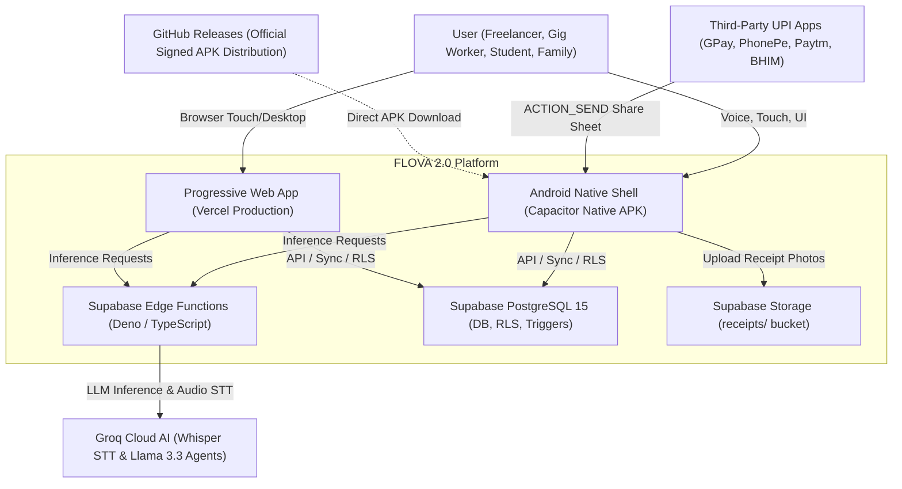
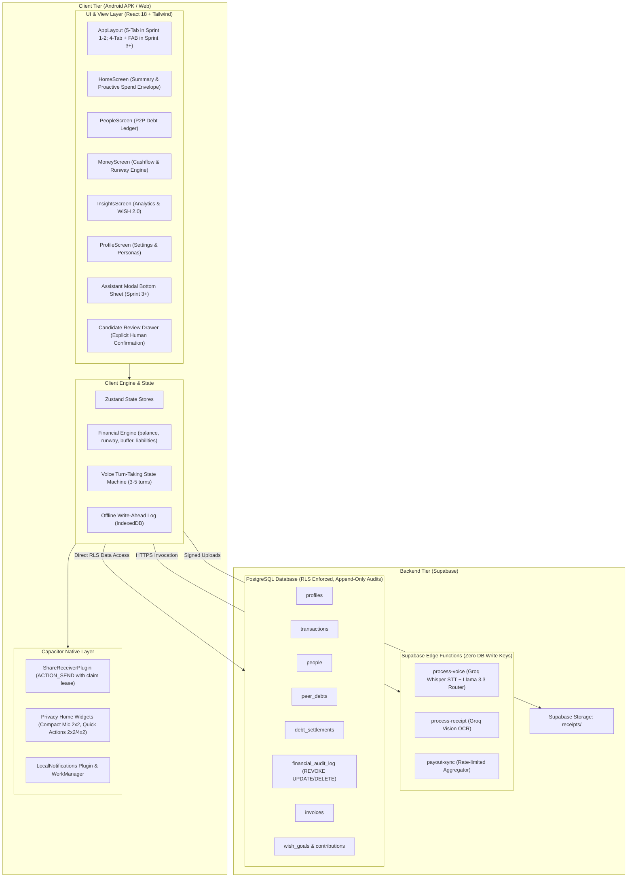
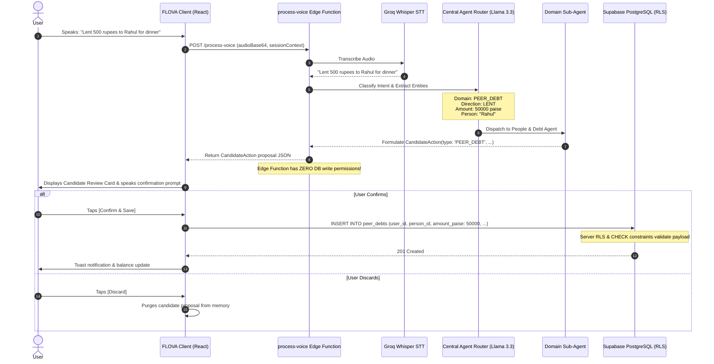

# FLOVA 2.0 — Target Technical Architecture Specification

**Document Version:** 2.0.0-PROD-PLAN-REV2  
**Status:** Approved Architectural Baseline  
**Date:** 2026-11-25  
**Author:** Principal System Architect & Lead Engineer  
**Repository:** `https://github.com/syed-imadulla/FLOVA`  
**Current Production Baseline:** `v1.0.1` (Commit `ab4bdef`)  
**Target General Availability:** `v2.0.0`

---

## 1. Architectural Principles & Non-Negotiable Directives

FLOVA 2.0 is engineered around eight inviolable architectural principles:

1. **Integer-Paise Precision:** All financial values are stored and calculated strictly as integer paise ($1\text{ INR} = 100\text{ paise}$). Floating-point math is prohibited in the domain core.
2. **Single Source of Truth & Multi-Stream Financial Segregation:** `transactions` (`income | expense` + nullable `inflow_category`) and `peer_debts` / `debt_settlements` never duplicate cash movements. Earned income is strictly segregated from family support, pocket money, gifts, donations, borrowing, lending, and repayments.
3. **Available Liquidity vs. Sustainable Runway:** Available Liquidity reflects immediate spendable cash over horizon $H$ ($C_{\text{owned}} - K_{\text{bills}}(H) - K_{\text{debt\_due}}(H) - B$). Sustainable Runway excludes all unpaid borrowed principal ($C_{\text{owned}} - L_{\text{outstanding}} - K_{\text{bills}}(H) - B$) so borrowed capital never inflates sustainable runway and liabilities are never double-counted.
4. **Custodial Money Isolation:** Cash in hand belonging to third parties (`not_mine` / COD delivery cash, unearned advances) is segregated and excluded from spendable runway.
5. **Human-in-the-Loop AI Safety & Dual-Layer Validation:** AI agents never perform automated direct writes to database tables. Agents emit structured candidate proposals; persistence requires explicit human confirmation. UI confirmation is a user interaction requirement, **not a substitute for server and database-level validation** (check constraints, triggers, and RLS).
6. **Defense-in-Depth Security & Append-Only Audit:** Every database table is protected by PostgreSQL Row Level Security (RLS) enforcing `auth.uid() = user_id`. Financial audit logs (`financial_audit_log`) are strictly append-only, enforced by revoking `UPDATE` and `DELETE` privileges and by trigger exceptions.
7. **Privacy-Preserving Native Widgets:** Home-screen widgets (Compact Mic 2×2, Quick Actions 2×2 / 4×2) are strictly action launchers and microphone deep links. **They never display financial balances, cash amounts, or private financial data on the Android launcher.**
8. **Permanent Release Identity & GitHub Distribution:** Sideloaded signed APKs distributed via **GitHub Releases** is the sole official distribution path. No Google Play or AAB packaging. Keystore is preserved outside git at `~/.android/flova-release.keystore`, key alias `flova-release`, RSA 4096-bit, Min SDK 24, compile SDK 36, target SDK 36, SHA-256 fingerprint verified (`3E:2E:D1:...`).

---

## 2. High-Level System Architecture (C4 Model)

### 2.1 System Context Diagram (Level 1)

---

### 2.2 Container Diagram (Level 2)

---

## 3. UI Navigation & Phased Transition Strategy

To protect system stability and avoid combining database migration risk with large-scale UI churn, navigation changes are phased:

### 3.1 Phase 1 (Sprint 1 & 2): Stable Foundation Shell
- **Navigation:** Preserves the battle-tested 5-tab navigation shell (`/app`, `/activity`, `/voice`, `/insights`, `/more`).
- **Scope:** Integrates candidate review cards with explicit confirmation, wire transaction taxonomy enhancements, and build the People Directory and Debt Ledger screens.

### 3.2 Phase 2 (Sprint 3+): 4-Tab Assistant Shell
- **Navigation:** Restructures `AppLayout.tsx` into 4 primary tabs: `People`, `Money`, `Insights`, `Profile`.
- **Center Floating Action Button (FAB):** Opens the persistent **Inline Assistant Modal Bottom Sheet** without unmounting or reloading the active background screen.
- **Candidate Review Drawer:** Expands inline to display the parsed `CandidateAction` requiring physical human tap on `[Confirm & Save]` or `[Discard]`.

---

## 4. Multi-Agent Backend & Edge Function Architecture

FLOVA 2.0 coordinates intent routing and domain logic across specialized sub-agents running inside Supabase Edge Functions:

### Key Security & Architecture Safeguards:
1. **Edge Functions are Stateless & Read-Only:** The `process-voice` function does NOT possess Supabase Service Role keys. It cannot write, mutate, or bypass RLS.
2. **Dual-Layer Validation:** 
   - Layer 1 (Interaction): Mandatory physical user confirmation tap.
   - Layer 2 (Engine & DB): PostgreSQL `CHECK` constraints (e.g. `amount_paise > 0`), foreign key integrity, and RLS policies (`auth.uid() = user_id`).
3. **IndicConformer Dormancy:** The `indicconformer/` service container remains completely dormant in production. Production STT is solely Groq Whisper Large v3 Turbo.

---

## 5. Privacy-Preserving Android Native Integration

The native Android layer (`frontend/android/app/src/main/java/in/flova/app/`) maintains absolute user privacy and keystore continuity:

1. **Home Widgets (Zero Financial Exposure):**
   - **Compact Mic Widget (2×2):** Large microphone button providing deep link to `/voice?record=true`. Contains only app branding and mic icon.
   - **Quick Actions Widget (2×2 default, 4×2 expanded):** Four launcher tiles (Voice, Add, Receipt, History).
   - **Privacy Rule:** Under no circumstances are account balances, daily spend numbers, cash totals, or transaction alerts rendered on home-screen widgets.
2. **Permanent Release Identity:**
   - Permanent keystore: `~/.android/flova-release.keystore` (outside repository).
   - Key alias: `flova-release`.
   - Algorithm: RSA 4096-bit.
   - Min SDK: 24, Compile SDK: 36, Target SDK: 36.
   - Fingerprint: `3E:2E:D1:B3:24:A8:A9:B3:0E:8A:07:E0:F5:52:D3:C0:6B:E8:9F:A9:4E:4B:C7:E0:A4:1D:F8:23:52:DA:34:D6`.
3. **Distribution Model:** Direct APK asset attached to tagged GitHub Releases. No Google Play dependencies.
